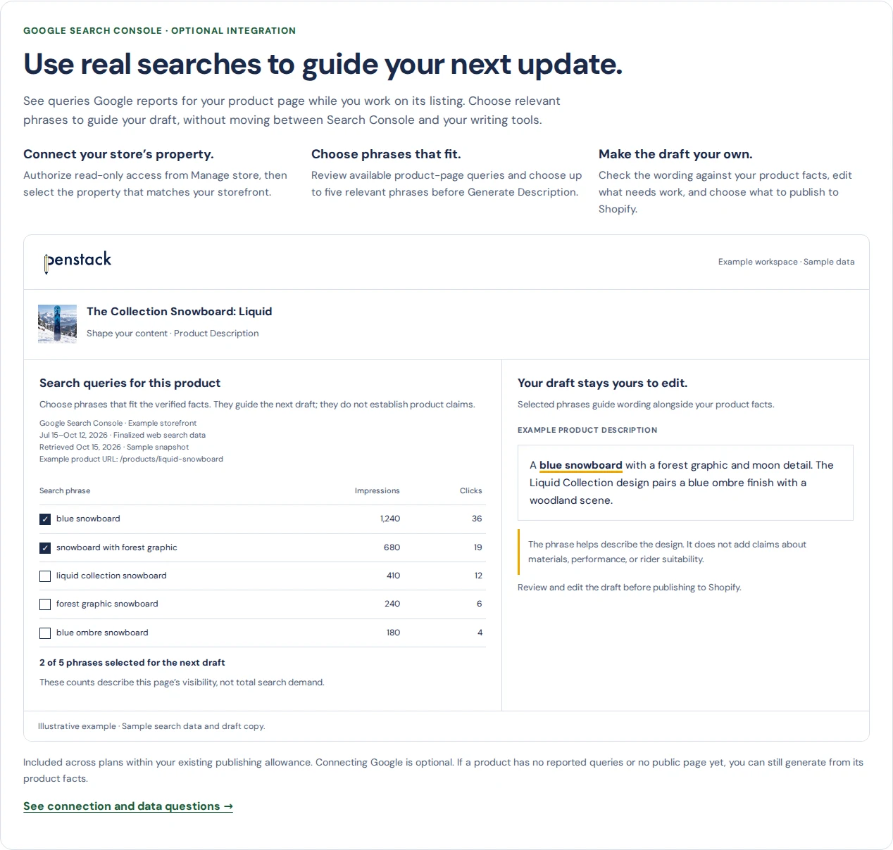

# Approved GSC website update — review gallery

Mallory approved these changes on October 15, 2026 (Pacific). This gallery records the approved pre-publication renders. The Home/Product search examples are reconstructed from the current app component with sample data. Existing Shopify screenshots remain actual product evidence.

## Home

The hero is preserved. A compact new section introduces query guidance and links to Product.

[Mobile Home](index-390.webp) · [Current Home baseline](before-index-1440.webp)

## Product

The generic search-context example is replaced with a query-to-draft demonstration. Sample rows, counts and draft text are labeled illustrative.

[Full desktop Product](product-1440.webp) · [Mobile section](product-section-390.webp) · [Full mobile Product](product-390.webp) · [Current Product baseline](before-product-1440.webp)

## Pricing and use cases

Pricing explicitly names optional GSC guidance across plans. Use Cases explains the listing-refresh task.

[Pricing desktop](pricing-1440.webp) · [Pricing mobile](pricing-390.webp) · [Use Cases desktop](use-cases-1440.webp) · [Use Cases mobile](use-cases-390.webp)

## Compare and buyer pages

Only Penstack's own GSC capability is clarified. No new competitor capability ratings are added. The agency and catalog pages connect existing workflows to optional query guidance.

[Compare desktop](compare-1440.webp) · [Compare mobile](compare-390.webp) · [Agency desktop](shopify-agency-workflows-1440.webp) · [Agency mobile](shopify-agency-workflows-390.webp) · [Catalog cleanup desktop](shopify-catalog-cleanup-1440.webp) · [Catalog cleanup mobile](shopify-catalog-cleanup-390.webp)

## Support and learning

Support includes connection and no-data answers. A practical setup/use guide is linked from the learning hub and relevant existing articles.

[Support desktop](support-1440.webp) · [Support mobile](support-390.webp) · [Expanded mobile FAQ](support-faq-390.webp) · [GSC guide desktop](blog-google-search-console-product-listings-1440.webp) · [GSC guide mobile](blog-google-search-console-product-listings-390.webp) · [Learning hub desktop](blog-index-1440.webp) · [Learning hub mobile](blog-index-390.webp)

## Validation

The validation reports record checks at 1440, 1024, 768, 390, and 320px, with DM Sans loaded and images decoded before measurement. Local links, anchor targets, image paths and structured-data syntax were checked. The new guide is visible under the learning hub's Level Up filter. Support disclosures open normally. This validates the marketing pages, not a live paid-store GSC connection.
